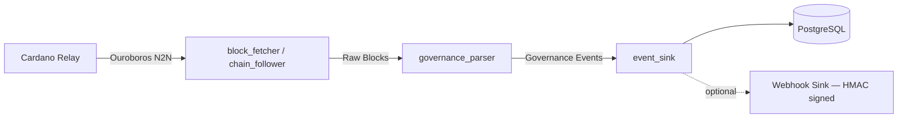

# Cardano Governance Indexer

A Rust service that indexes Cardano on-chain governance activity — DRep registrations, delegations, proposals, and votes — in compliance with the **CIP-1694 (Voltaire)** specification. It connects directly to a Cardano relay over Ouroboros Node-to-Node, decodes Conway-era governance certificates and transactions, and writes a normalized event timeline to PostgreSQL for consumption by the [www.1694.io](https://www.1694.io) frontend.

## 1. Architecture

The indexer is a staged pipeline built on [Pallas](https://github.com/txpipe/pallas) (chain sync) and [Gasket](https://github.com/construkts/gasket-rs) (SEDA-style staged pipelines):



### Pipeline stages (`src/pipeline/stages/`)
* **`block_fetcher.rs`** (`HistoricalFetcherStage`) — parallel historical catch-up across epoch ranges.
* **`chain_follower.rs`** (`ChainFollowerStage`) — continuous chain-tip monitoring after history is caught up.
* **`governance_parser.rs`** (`GovernanceParserStage`) — extracts Conway governance certs/txs (`regDrepCert`, `voteDelegCert`, `txvote`, `txprop`, etc.) and serializes `GovAction`s to JSON (`src/parser/`).
* **`event_sink.rs`** (`EventSinkStage`) — fans events out to configured sinks.

### Sinks (`src/sinks/`)
* **`postgres.rs`** — writes to the `drep_timeline_event` table, idempotent via `ON CONFLICT (tx_hash, tx_index) DO NOTHING`.
* **`webhook.rs`** — optional HMAC-signed HTTP push, enabled via `SINK_WEBHOOK_ENABLED`/`SINK_WEBHOOK_URL`.

> Note: an earlier version of this project used a `scanner`/`monitor` module split — that has since been replaced by the `pipeline`/`sinks` architecture above.

## 2. Governance Specifications & Standards

The indexer's parsing logic follows these formal specs:

* **[Conway Ledger Formal Specification](https://github.com/IntersectMBO/cardano-ledger/tree/master/eras/conway/impl/README.md)** — DReps, Governance Actions, Voting rules.
  * **GovActionID**: `TxId + Index`.
  * **Voter Roles**: CC (Constitutional Committee), DRep, SPO.
  * **Action Types**: NoConfidence, UpdateCommittee, NewConstitution, TriggerHF, ChangePParams, TreasuryWdrl, Info.
* **[CIP-1694](https://github.com/cardano-foundation/CIPs/tree/master/CIP-1694)** — On-Chain Decentralized Governance.
* **[CIP-105](https://github.com/cardano-foundation/CIPs/tree/master/CIP-105)** — DRep ID Format.
* **[CIP-119](https://github.com/cardano-foundation/CIPs/tree/master/CIP-119)** — DRep Metadata Standards (JSON-LD).
* **[CIP-129](https://github.com/cardano-foundation/CIPs/tree/master/CIP-129)** — Governance Entity Bech32 Encoding.

## 3. Data Model

### `drep_timeline_event`
Single table holding every DRep-related event, keyed uniquely on `(tx_hash, tx_index)`.

| Column | Type | Description |
|---|---|---|
| `event_type` | `text` | `registration`, `delegation`, `voting_activity`, `retirement` |
| `timestamp` | `timestamptz` | Block time of the event |
| `epoch` | `bigint` | Cardano epoch number |
| `slot` | `bigint` | Absolute slot number |
| `tx_hash` | `text` | Transaction hash |
| `drep_id` | `text` | DRep ID (CIP-105/129) |
| `metadata` | `jsonb` | Event-specific payload |

Plus denormalized `stake_address`/`previous_drep` columns (`db/denormalize.sql`) for faster lookups.

### `sync_checkpoint`
Tracks sync progress per worker (`historical_0`, `historical_1`, ..., `continuous`), written every 1000 blocks during historical sync and every block during continuous sync.

### Event payload examples (JSONB `metadata`)

**Registration**
```json
{ "drep_id": "drep1...", "deposit": "500000000", "anchor_url": "https://...", "anchor_hash": "..." }
```

**Delegation**
```json
{ "stake_address": "stake1...", "target_drep": "drep1...", "previous_drep": "drep1... (or null)", "added_power": true }
```

**Voting Activity**
```json
{ "vote": "Yes/No/Abstain", "gov_action_proposal_id": "tx_hash", "vote_rationale": "Reason derived from anchor url..." }
```

## 4. Usage Guide

### Prerequisites
* Docker + Docker Compose (recommended path), or a local Rust **nightly** toolchain (edition 2024) if running outside Docker.
* A reachable Cardano relay (mainnet/preprod/preview).
* Copy `.env.example` to `.env` and fill in values (used for local dev only — never baked into Docker images; production gets env vars from Kubernetes).

### Quickest start — Docker Compose
```bash
make up-detach     # start postgres + indexer in the background
make logs          # follow indexer logs
make status        # print checkpoint + event stats
make down          # stop everything
```
Postgres is exposed on host port `5433`, schema auto-applied from `db/init.sql` on first boot.

### Building a release binary
```bash
make build         # builds inside rustlang/rust:nightly-slim, caches via docker volumes
```
or locally:
```bash
cargo build --release
```

### CLI subcommands
Run via `cargo run -- <subcommand>` locally, or `docker compose run --rm indexer <bin> <subcommand>` (the Makefile wraps the common ones):

| Subcommand | Description |
|---|---|
| `start` | Run historical sync, then continuous chain-tip monitoring |
| `sync-history` | Historical sync only |
| `status` | Print checkpoint and event stats (`make status`) |
| `monitor` | Run continuous monitor only (`make monitor`) |
| `reconcile [--sql-only] [--dry-run]` | Audit/fix known data discrepancies (`make reconcile-dry`, `make reconcile`) |
| `wipe --force` | TRUNCATE event + checkpoint tables — destructive (`make wipe`) |
| `reset --force` | Clear checkpoints only, keep events (`make reset`) |
| `stop` / `pause` / `continue` | Signal a running process via its PID file (`.indexer.pid`) |

### Environment variables

**Database**
| Variable | Description |
|---|---|
| `DATABASE_URL` | PostgreSQL connection string (required, must start with `postgres://`) |
| `DB_MAX_CONNECTIONS` / `DB_MIN_CONNECTIONS` | Pool sizing |
| `DB_ACQUIRE_TIMEOUT_SECS` | Connection acquire timeout |
| `DB_RETRY_ATTEMPTS` / `DB_RETRY_DELAY_SECS` | Connection retry policy |

**Network**
| Variable | Description |
|---|---|
| `RELAY_ADDRESSES` | Comma-separated list of relay `host:port` entries |
| `RELAY_ADDRESS` | Single relay, merged into the list above |
| `NETWORK_MAGIC` | `764824073` (mainnet), `1` (preprod), `2` (preview) |
| `CONNECTION_TIMEOUT_SECS` / `RETRY_ATTEMPTS` | Relay connection resilience |

**Processing**
| Variable | Description |
|---|---|
| `MAX_CONCURRENT_WORKERS` | Parallel historical-sync workers (default `10`) |
| `BATCH_SIZE` | DB transaction batch size (default `1000`) |
| `CONTINUOUS_SYNC_INTERVAL_SECS` | Poll interval once chain tip is reached |
| `SLOT_HASHES_FILE` | Path to `slot_hashes.csv` (see below) |

**Webhook sink** (optional, not in `.env.example` yet)
| Variable | Description |
|---|---|
| `SINK_WEBHOOK_ENABLED` | Enable the HMAC-signed webhook sink |
| `SINK_WEBHOOK_URL` | Destination URL |
| webhook secret | Used to HMAC-sign the payload (see `src/sinks/webhook.rs`) |

### Generating `slot_hashes.csv`
The indexer needs known slot/hash checkpoints from the Conway hard fork (epoch 507) onward to bootstrap chain sync. Regenerate it with:
```bash
BLOCKFROST_PROJECT_ID=<your_project_id> ./fetch_block_hashes.sh
```
This queries Blockfrost per-epoch and writes `slot,hash` rows to `slot_hashes.csv` (path configured via `SLOT_HASHES_FILE`). Requires `jq`.

### Database schema / migrations
There's no migration tool (no sqlx-cli/diesel) — schema is plain SQL applied manually or via Docker Compose init:
* `db/init.sql` — `drep_timeline_event` + indexes (auto-applied by `docker-entrypoint-initdb.d` on first Postgres boot)
* `db/checkpoint.sql` — `sync_checkpoint` table
* `db/denormalize.sql` — adds `stake_address`/`previous_drep` columns

### Reconciler
Known discrepancies (e.g. constant-DRep vote `drep_id` nulled by a `drep-`/`drep_` mismatch) and the fix plan are documented in [reconciler-plan.md](reconciler-plan.md). SQL-only fixes can be run immediately; the `reconcile` subcommand runs the full Audit → Fetch (Blockfrost) → Patch pipeline, intended to run as a nightly Kubernetes CronJob alongside the main deployment.

## 5. Deployment

CI/CD is GitLab-based (`.gitlab-ci.yml`):
* **build** stage — builds the production image from `Dockerfile` (multi-stage: `rustlang/rust:nightly-slim` builder → `debian:bookworm-slim` runtime), pushes to `registry.2lovelaces.io/voltaire/governance-indexer`.
* **deploy** stage — triggers a downstream Helm-based pipeline in `voltaire/www.1694.io` to roll out to preview (on `dev`) or production (on `main`).

In Kubernetes, all configuration comes from env vars injected by the deployment manifest — no `.env` file is ever baked into the image.

## 6. Spec-Driven Development

Changes to this project follow an SDD workflow: spec → failing tests → minimal implementation → verify against spec → update roadmap.

* **Constitution**: [`.claude/docs/project-constitution.md`](.claude/docs/project-constitution.md)
* **Roadmap**: [`.claude/docs/roadmap.md`](.claude/docs/roadmap.md)
* **Specs**: [`.claude/docs/specs/`](.claude/docs/specs/) — one file per feature, drafted from [`template.md`](.claude/docs/specs/template.md) before implementation begins

See [CLAUDE.md](CLAUDE.md) for the full engineering context used by AI assistants working on this repo.
